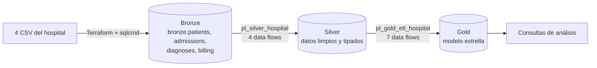
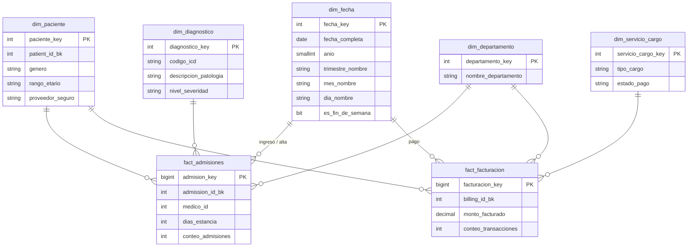

# Examen Azure: Data Warehouse Hospital (Bronze, Silver y Gold)

Universidad Católica Boliviana · SIS-226 Sistemas de Soporte a las Decisiones Gerenciales
Examen competencia 1 y 2 (50%) · Trabajo individual

Data warehouse de un hospital en Azure con arquitectura Medallion. El ambiente se reconstruye con el Terraform del curso,
que deja la capa **Bronze** cargada. La capa **Silver** limpia los datos y la capa **Gold** arma un modelo estrella.
Las dos se cargan con **Azure Data Factory** (data flows y pipelines).

## Arquitectura



| Recurso | Nombre |
| --- | --- |
| Grupo de recursos | `gr-ucb-hospital` |
| Servidor SQL | `sql-ucb-server-hospital-ale2026` |
| Base de datos | `dw_hospital` (serverless) |
| Data Factory | `adf-ucb-hospital-us-ale2026` |
| Servicio vinculado | `ls_sql_dw_hospital` |

## Estructura del repositorio

| Carpeta | Contenido |
| --- | --- |
| `terraform/` | `main.tf` y los scripts SQL que crean bronze, silver, gold y cargan bronze |
| `sql/` | Scripts de apoyo: funciones de limpieza, procedimientos, consultas de los data flows, validaciones y análisis |
| `adf/` | Pipelines, data flows y datasets de Data Factory (integración con Git) |
| `datos/` | Los 4 CSV originales |
| `docs/capturas/` | Capturas del informe |

## Cómo ejecutarlo

1. Ambiente:
   ```bash
   az login
   cd terraform
   terraform init
   terraform plan
   terraform apply
   ```
   Requiere `sqlcmd` instalado. Al terminar, bronze tiene 1015 pacientes, 1800 admisiones, 2200 diagnósticos y 2200 cargos.
2. En el Editor de consultas de `dw_hospital`: `sql/01_preparar_silver.sql` y `sql/04_preparar_gold.sql`.
3. En Data Factory: ejecutar `pl_silver_hospital` y después `pl_gold_etl_hospital`.
4. Validar con `sql/03_validacion_silver.sql` y `sql/06_validacion_gold.sql`.
5. Analizar con `sql/07_consultas_analisis.sql`.
6. Al terminar: `terraform destroy`.

## Capa Silver

Un data flow por tabla (`df_silver_patients`, `df_silver_admissions`, `df_silver_diagnoses`, `df_silver_billing`).
Cada uno lee bronze con una consulta de limpieza y escribe en la tabla silver. El pipeline `pl_silver_hospital` vacía
silver con `silver.usp_limpiar_silver` y carga en orden de dependencias.

| Problema en bronze | Ejemplo | Regla |
| --- | --- | --- |
| Fechas en 5 formatos | `07-27-24`, `13-Jul-2024`, `July 13, 2024`, `07/27/2024`, `2024-07-28` | `silver.fn_Fecha` → DATE |
| Fecha de nacimiento de relleno | `1890-01-01`, `2027-01-01` | NULL |
| Año de 2 dígitos en el futuro | `07-25-41` | 1941 |
| Género | `m`, `male`, `F`, `FEMALE` | `M` / `F` |
| Teléfono | `(945) 231-5828`, `+12426459639`, `unknown` | 10 dígitos o NULL |
| Email | `gmail,com`, `gmial.com`, `x at yahoo.com` | Corregido; sin `@` → NULL |
| Seguro | `Aetnaa`, `Blue-Cross`, `UHC`, `Medi-care`, `self pay`, `N/A` | Nombre único; vacío → NULL |
| Pacientes duplicados | id 1002 = id 14 (mismo nombre y fecha de nacimiento) | Se conserva el id más bajo; sus admisiones pasan a ese id |
| Departamento | `Cardiolgy`, `Onco`, `Peds`, `ER`, `Nuerology`, `Gen Surg` | 7 departamentos |
| Admisión sin fecha | celda vacía | Excluida |
| Paciente inexistente | `patient_id` 1255 | Excluida (FK de silver) |
| Alta antes de la admisión | 19 filas | Alta = NULL |
| Código ICD | `M54-5`, `M545`, ` m54.5 ` | `silver.fn_ICD` → `M54.5` |
| Severidad | `mild`, `SEVERE` | `Mild`, `Moderate`, `Severe`, `Critical` |
| Monto | `$1,181.81`, `USD 5,344.32`, `4735.947104` | DECIMAL(12,2) |
| Monto vacío o mayor a 20.000 | atípicos | Excluido |
| Estado de pago | `PAID`, `pending` | `Paid`, `Pending`, `Unpaid`, `Overdue` |
| Diagnóstico o cargo sin admisión válida | `admission_id` 1893 | Excluido (FK) |

| Tabla | Bronze | Silver |
| --- | --- | --- |
| patients | 1015 | 1000 |
| admissions | 1800 | 1689 |
| diagnoses | 2200 | 1991 |
| billing | 2200 | 1925 |

## Capa Gold: modelo estrella



Un data flow por tabla y el pipeline `pl_gold_etl_hospital`: limpia gold, carga las 5 dimensiones y después los 2 hechos.
Los hechos buscan sus claves en las dimensiones dentro de la consulta de origen.

| Tabla | Filas |
| --- | --- |
| dim_fecha | 1268 |
| dim_paciente | 1000 |
| dim_departamento | 7 |
| dim_diagnostico | 51 |
| dim_servicio_cargo | 28 |
| fact_admisiones | 1689 |
| fact_facturacion | 1925 |

Decisiones:
- Una admisión puede tener varios diagnósticos: se usa el más grave como diagnóstico de la admisión. Las 522 admisiones sin diagnóstico apuntan a la fila `SIN-DX`.
- La descripción de diagnóstico del CSV es texto de relleno; `dim_diagnostico` usa el nombre oficial ICD-10.
- `fecha_alta_key` y `fecha_pago_key` quedan NULL cuando no hay alta o pago.
